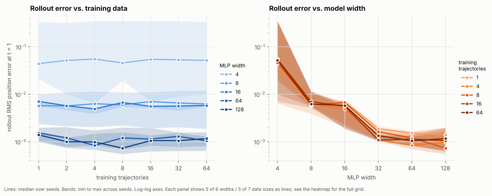
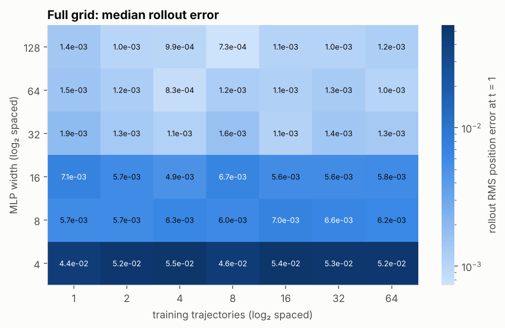
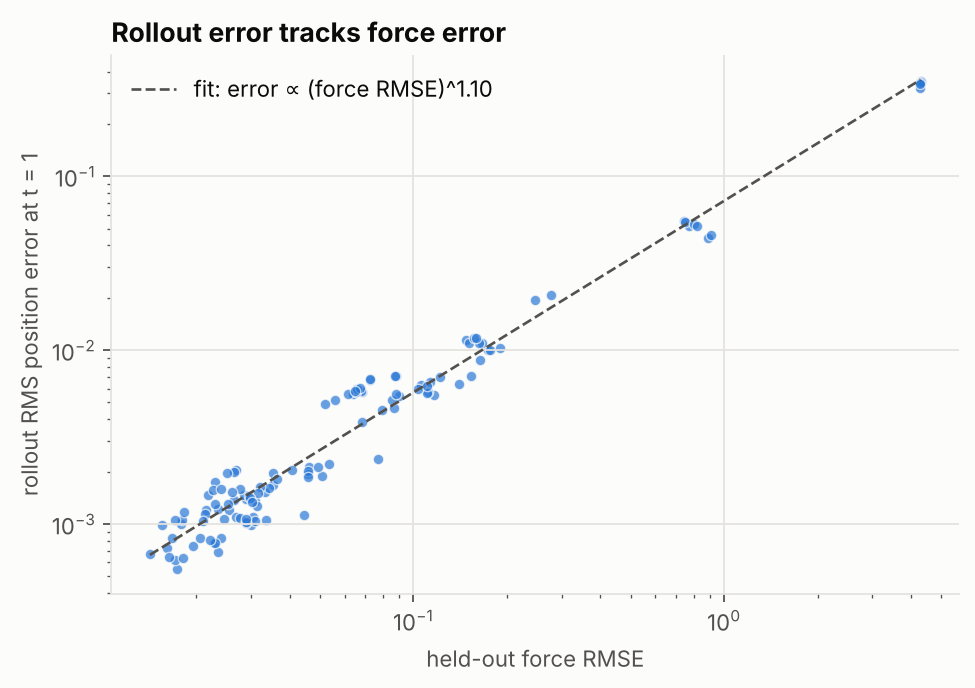

# Rollout error vs. training trajectories and model width

**How far does a simulation driven by a learned potential stray from the truth, and what buys accuracy: more training data or a bigger network?**

This repo trains 126 [Equinox](https://docs.kidger.site/equinox/) MLP pair potentials, one for each combination of

- **training data:** 1, 2, 4, 8, 16, 32 or 64 molecular-dynamics trajectories,
- **model width:** 4, 8, 16, 32, 64 or 128 hidden units (2 hidden layers),
- **seed:** 0, 1 or 2.

It then measures the **rollout error** of each one: run MD with the learned forces and with the true forces from the same unseen start, and record how far apart the atoms end up. Everything is plotted on log-log axes, where a straight line means a power law.

The model, data generator and integrator come from [**Equinox-MLP**](https://github.com/sjd18/Equinox-MLP) (`eqxmlp`), which is installed as a dependency.

<p align="center"></p>

## Findings

| | Result |
|---|---|
| **Width** | Rollout error falls **30–60×** from width 4 to width 128 (median ≈5e-2 to ≈1e-3, depending on data size). Fitted log-log slopes are **−0.93 to −1.14** for every data size. |
| **Training data** | Essentially **no effect** between 1 and 64 trajectories: slopes −0.05 to +0.03 at every width. |
| **Shape of the width curve** | Not a clean power law. It drops in steps: width 4 (≈5e-2) → widths 8–16 (≈6e-3, a plateau) → width 32 (≈1.3e-3) → widths 64–128 (≈1e-3, flattening). Excluding width 4, the slope is −0.73. |
| **Force error → rollout error** | Across all 126 models, rollout error ∝ (held-out force RMSE)^**1.11**. Short-horizon rollout error is almost proportional to force error. |
| **Best model** | 8 trajectories, width 128: rollout error **5.5 × 10⁻⁴** at t = 1. |
| **Compute** | 2.6 CPU-hours of training in total, from about 7 s per model at width 4 to about 4 minutes at width 128. |

**Why doesn't data help?** In this setup, one trajectory is already a lot of data for this model. Each trajectory contributes 91 frames × 120 atom pairs ≈ 11,000 pair distances covering the whole interaction range, and the model only has to learn a one-dimensional function φ(r). The bottleneck is how well the network can represent that function within the 2,000-step training budget, which is set by width. (See [Caveats](#caveats) for where data *would* start to matter.)

## What exactly is measured

**Rollout error at time t.** From each of 16 held-out starting states (16 atoms, temperature 0.35), integrate velocity Verlet twice: once with the true Lennard-Jones forces and once with the model's forces `−∇V_θ`. The error is

```math
\varepsilon(t) = \Big\langle \sqrt{\tfrac{1}{N d}\textstyle\sum_{i}\lVert q_i^{\text{model}}(t) - q_i^{\text{true}}(t)\rVert^2} \Big\rangle_{\text{16 starts}}
```

recorded at t = 0.5, 1 and 2.5 (100, 200 and 500 steps of dt = 0.005). The headline horizon is **t = 1**.

**Why t = 1?** MD is chaotic: any force error grows until the two runs are unrelated. By t ≈ 5, every model's error saturates at about 0.15–0.2, roughly the size of the cluster, and stops telling models apart. At t = 1 it is still in the regime where error tracks model quality (see the force-error plot below, and `tests/test_rollscale.py`, which checks that doubling a small force error doubles the rollout error).

**Training sets.** A pool of 64 ground-truth trajectories spans temperatures 0.21–0.49. A training set of *n* trajectories takes *n* of them spread evenly through the pool, so every set covers the temperature range as evenly as its size allows. *n* = 1 uses the middle (0.35) trajectory.

**Training.** Force matching (energy + force loss, from `eqxmlp.train`), Adam with cosine decay, learning rate 3e-3, batch 64, and the **same 2,000 steps for every model**. Seeds set the initial weights and minibatch order; the training data for a given *n* is the same across seeds.

**Also recorded per model:** force RMSE and R² on 728 held-out frames, final loss, parameter count and training time. See `results/sweep.csv`.

## More results

### The full grid

<p align="center"></p>

Every column looks alike (data barely matters); the rows change sharply (width matters a lot).

### Rollout error tracks force error

<p align="center"></p>

Each dot is one trained model. The tight log-log line shows that short-horizon rollout error is essentially a readout of force accuracy, so the rollout metric is measuring the model rather than chaos.

### Other horizons

| Horizon | Width slopes (one per data size) |
|---|---|
| t = 0.5 | −1.01 to −1.15 |
| **t = 1** | **−0.93 to −1.14** |
| t = 2.5 | −0.81 to −0.98 |

Slopes get shallower at longer horizons because chaos amplifies everyone's error toward the same ceiling. Regenerate any horizon's figures with `python scripts/plot_results.py --metric rollout_t2.5`.

## Quickstart

```bash
git clone https://github.com/sjd18/rollout-error-vs.-training-trajectories.git
cd rollout-error-vs.-training-trajectories
pip install -e ".[dev]"
```

**Explore the existing results** (no training needed):

```bash
python scripts/plot_results.py        # figures -> assets/, slopes -> terminal and assets/slopes.txt
```

or open the notebook [`notebooks/explore_results.ipynb`](notebooks/explore_results.ipynb) (`pip install -e ".[notebook]"`). It has the plots, slope table and other horizons, plus a cell that runs a 4-model mini sweep in under a minute.

**Re-run the sweep yourself.** Results are saved after every model, and re-running skips finished ones, so you can stop and resume at any time.

```bash
python scripts/run_sweep.py --quick   # 2-minute smoke test (undertrained on purpose)
python scripts/run_sweep.py           # the full grid: ~2 h on one 4-core CPU process
```

Faster on 4+ cores, split into two shards (one per terminal), then merge:

```bash
python scripts/run_sweep.py --shard 0 2
python scripts/run_sweep.py --shard 1 2
python scripts/merge_results.py --delete-shards
```

Width 128 is about 60% of the compute; `--widths 4 8 16 32 64 --seeds 0 1` runs in roughly a third of the time. Any grid works: `--n-trajs`, `--widths`, `--seeds` and `--steps` are all options, and the plotting script adapts to whatever is in the CSV.

**Use the metric on your own model:**

```python
import jax

jax.config.update("jax_enable_x64", True)
import rollscale as rs

starts = rs.test_starts(jax.random.PRNGKey(1000), n=16)
rs.rollout_error(my_model.forces, starts)  # {0.5: ..., 1.0: ..., 2.5: ...}
```

## Caveats

- **Data range.** Data didn't matter here because the test starts (temperature 0.35) sit inside the temperature range of every training set, including the single middle trajectory. Testing at temperatures outside the training range, using fewer frames per trajectory, or learning a harder (many-body) potential would all make data matter more. Fractions of a trajectory would be the natural next axis to add.
- **Fixed training budget.** Every model gets 2,000 steps. Wider models might improve further with longer training; the width-8 to width-16 plateau may be an optimisation effect rather than a capacity limit. These are results at fixed compute per model, not at convergence.
- **Seeds are shared across data sizes.** Seed *s* gives the same initial weights at every *n*. At width 4, seed 1 fails to learn at all (force R² ≈ 0) at every data size. That's one bad initialisation repeated, which produces the wide band in the left panel. It's included because it's real behaviour of tiny networks.
- **Line families.** Each line panel shows 5 of the 6 widths or 5 of the 7 data sizes, because at most 5 shades of one colour pass the colour-distinguishability check. Every value still appears on the x-axes, and the heatmap shows the whole grid.
- **Small system.** 16 atoms in 2-D with a pairwise potential: a teaching-scale study, not a production force field.

## Repository layout

```text
src/rollscale/
  data.py        trajectory pool and evenly spread training subsets
  metrics.py     rollout error vs true-force MD (vmapped over starts)
  sweep.py       resumable, shardable grid sweep -> CSV
  plotting.py    log-log scaling panels, heatmap, force-vs-rollout scatter
scripts/         run_sweep.py, merge_results.py, plot_results.py
results/         sweep.csv (126 runs) and the exact sweep config
assets/          figures and slopes.txt
notebooks/       explore_results.ipynb
tests/           pytest suite
```

## Testing

```bash
pytest -q        # 13 tests, ~20 s on CPU
```

The tests cover:
- the rollout metric: exactly zero for true forces, proportional to small force errors, growing with horizon, and `inf` for runs that blow up;
- evenly spread, nested training subsets;
- the sweep's CSV output, resuming, and shard ownership after restarts;
- power-law slope fitting;
- that every figure renders.

## References

1. Equinox-MLP: the pair-potential model, data and integrator used here. [github.com/sjd18/Equinox-MLP](https://github.com/sjd18/Equinox-MLP)
2. P. Kidger, C. Garcia. *Equinox: neural networks in JAX via callable PyTrees and filtered transformations.* [docs.kidger.site/equinox](https://docs.kidger.site/equinox/)
3. JAX documentation: [Thinking in JAX](https://docs.jax.dev/en/latest/notebooks/thinking_in_jax.html), [The Autodiff Cookbook](https://docs.jax.dev/en/latest/notebooks/autodiff_cookbook.html).
4. J. Kaplan et al. *Scaling laws for neural language models.* 2020. (Background for log-log scaling plots.)
5. S. Batzner et al. *E(3)-equivariant graph neural networks for data-efficient and accurate interatomic potentials* (NequIP). Nat. Commun. 13 (2022). (Data efficiency in learned force fields.)

## License

MIT; see [LICENSE](LICENSE).
